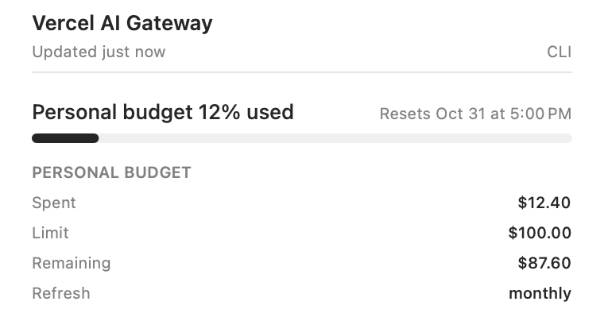
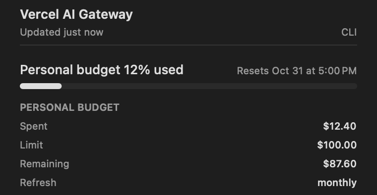
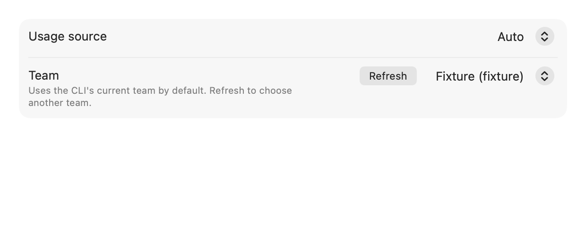

# Vercel AI Gateway

Enable **Vercel AI Gateway** in Settings → Providers and enter an AI Gateway API key, or set
`AI_GATEWAY_API_KEY` for the CLI. The key is saved in CodexBar's local config file when entered in Settings.
Use `codexbar usage --provider vercel --source api` to fetch it.

## Personal budget with Vercel CLI

No additional access token or team ID needs to be copied into CodexBar. Install Vercel CLI and sign in
with `vercel login`. Automatic mode discovers the CLI's current team and reads your personal budget.
The Gateway API key is not required for CLI budgets.

To use another team, open Settings → Providers → Vercel AI Gateway, click **Refresh** beside **Team**,
and choose a team by name. The choice is saved only in CodexBar; it does not switch the CLI's global
team. Choose **Auto** to follow the CLI's current team again. **Usage source** also lets you select
**Vercel CLI** explicitly, or **API key** to keep the original team-credit view.

For the CodexBar CLI, use `codexbar usage --provider vercel --source cli`; no team ID is needed when
the Vercel CLI already has a current team. `VERCEL_TEAM_ID` remains an optional explicit override.
Explicit `--source api` always reads the Gateway key's team credits, even with a team override.

CodexBar runs read-only `vercel api` commands with JSON output:

- `vercel teams list --format json` discovers memberships and the current CLI team. Pagination is
  followed for up to 20 pages; incomplete, repeated, or ambiguous results fail instead of selecting
  the first team. This command is also used by the settings team's **Refresh** action.
- `/v2/user` identifies the signed-in CLI user.
- `/ai-gateway/budgets/list?teamId=...&scopeType=user` supplies that team's personal budgets.

The budget request uses `limit=200` and follows `nextCursor` with the same team scope on every page.
This keeps large teams' responses within the CLI's 1 MiB output limit. Up to 100 pages are read;
repeated cursors, incomplete traversal, and failed pages fail the refresh without publishing a partial budget.
Team discovery, user identification, and all budget pages share a 30-second monotonic deadline.
Each command gets at most 15 seconds, capped by the remaining time. The settings team's **Refresh**
action has its own 30-second deadline. Responses arriving after the deadline are rejected.

The personal budget is matched by user ID, never by the first list entry or a display name. A custom
budget takes precedence over an inherited default. The card shows spend, limit, remaining personal
allowance, and the refresh cadence. Daily, weekly, and monthly budgets reset at UTC boundaries;
weekly budgets reset on Monday. A cumulative (`none`) budget has no reset date.

Vercel does not participate in generic plan-utilization history or burn-down widgets. Personal budgets
belong to a user within a team; a provider-wide history bucket cannot represent that ownership safely.
Existing history is preserved on disk, but is neither displayed nor extended by this provider.

When no active personal budget exists, CodexBar says so without inventing a usage percentage or spend.
In automatic mode without an explicit team override, a failed CLI fetch can fall back to the configured
Gateway key's team-credit view. Explicit CLI mode and explicit team choices surface failures instead.
When fallback succeeds, a diagnostic explains that team credits are being shown because the CLI
personal budget was unavailable. Timeout and oversized-response errors are distinguished without
exposing raw CLI output.
The CLI source describes the signed-in user in the selected team; it does not infer the owner of a Gateway key.
It works with CLI versions that support `vercel api --raw --non-interactive`, even without the newer
`vercel ai-gateway` subcommand. Every team role except Contributor can read budgets.

Only keys with **User** spend attribution count toward this personal budget. A key created by a person
can still have **Team** attribution. Team and key budgets, and the team's credit balance, can stop requests
before the personal allowance runs out. BYOK spend does not count toward these budgets.

Synthetic personal-budget examples in light and dark appearances:

Synthetic source and team settings:

## Team credits with an API key

The bundled JavaScript plugin reads `GET https://ai-gateway.vercel.sh/v1/credits` with bearer authentication.
It displays the key's **team-wide remaining USD balance** and **lifetime USD spend**, from the documented
`balance` and `total_used` decimal strings. Zero and negative balances are preserved. Missing or malformed
values fail the refresh; they do not become zero. The shared HTTP host bounds requests and retries transient failures.

This endpoint has no spending limit or reset date, so this source shows amounts without a percentage bar,
reset countdown, or billing-period estimate. The API-key source does not use Vercel CLI credentials.
Select the appropriate team's API key to change its scope. Neither source imports browser cookies,
reads Keychain directly, changes budgets, makes inference requests, or uses the metered Custom Reporting API.

Sources: [REST credit API](https://vercel.com/docs/ai-gateway/sdks-and-apis/rest-api#check-credit-balance),
[usage semantics](https://vercel.com/docs/ai-gateway/observability-and-spend/usage), and
[reporting pricing](https://vercel.com/docs/ai-gateway/observability-and-spend/custom-reporting#pricing).
Personal budgets: [budget semantics](https://vercel.com/docs/ai-gateway/observability-and-spend/budgets),
[list budgets API](https://vercel.com/docs/rest-api/ai-gateway/list-ai-gateway-budgets), and
[spend attribution](https://vercel.com/docs/ai-gateway/authentication-and-byok/api-keys#spend-attribution).
